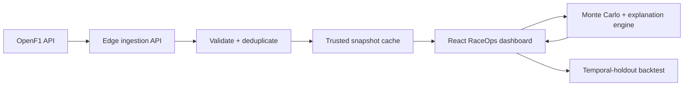

# PitWall

**Cloud-hosted Formula 1 race-strategy and telemetry-resilience simulator powered by OpenF1 data and Monte Carlo modeling.**

[Launch the live demo](https://pitwall-race-strategy.arisharazakhan.chatgpt.site)

PitWall recreates a race engineer's decision surface and the reliability controls behind it. Select a driver, scrub through a Grand Prix lap by lap, test a tyre compound and pit window, then deliberately break the telemetry pipeline and watch PitWall preserve the last trusted race state.

The default experience is a playable **Race Engineer Mission**: advance a live race, watch cars move around the circuit, issue pace commands, respond to race events, call a pit stop, compare against a ghost strategy, and receive an explainable engineering score at the chequered flag.

## Engineering highlights

- Synchronizes **7 OpenF1 endpoints** for sessions, drivers, laps, positions, intervals, tyre stints, and weather across **five circuit profiles**.
- Reconstructs lap-aligned race snapshots across the full driver field, keeping positions, gaps, tyres, pace, and conditions on the same timestamp.
- Runs reproducible **1,000-path decisions** or an asynchronous **100,000-path stress test** with live convergence telemetry.
- Produces expected finishing position, time delta, podium and win probabilities, an **80% outcome interval**, and undercut/hold/overcut comparisons.
- Routes OpenF1 through a **Cloudflare Workers-compatible edge API** with input validation, request timeouts, cache control, stale-while-revalidate behavior, and correlation IDs.
- Includes a temporal-holdout **Backtest Lab** that freezes inputs at a chosen lap, seals future data, and scores the prediction against the observed result.
- Includes a backend **failure-injection lab** for upstream outages, measured latency, telemetry tampering, replay storms, and weather-feed loss.
- Implements circuit-breaking behavior, last-known-good cache failover, schema/range validation, event deduplication, confidence penalties, and an immutable-style operational audit view.

## Interactive features

- Three replayable missions: Silverstone weather crossover, Monaco undercut, and Singapore safety-car timing
- Fixed scenario seeds for reproducible race state and pit-stop variance
- Pause and 1×/2×/4× race speed
- Animated car movement, timing tower, lap progress, rain front, and tyre wear
- Decision interruptions for weather crossover and attack windows
- Working BOX command with pit-stop delay, tyre change, rejoin loss, and radio confirmation
- PUSH, BALANCED, and CONSERVE driver modes that alter pace and degradation
- Live alternative-strategy ghost with changing time delta
- Transparent 100-point scoring across position, compound, timing, pace, risk, and reaction time
- Post-race decision analysis comparing the player's call against the modeled optimum
- Lap-by-lap historical race replay
- Driver selection and running-order tracking
- Real pace-delta visualization
- Tyre compound and pit-lap controls
- Dry, light-rain, and heavy-rain scenarios
- Safety-car strategy modeling
- Track-position and weather visualizations
- Seeded simulations for reproducible comparisons
- Telemetry Trust Center with health, latency, queue, integrity, cache, and circuit-breaker metrics
- Controlled cyber-resilience scenarios that visibly affect model confidence and data-source state
- Multi-circuit modeling for Silverstone, Monaco, Monza, Spa, and Singapore
- Per-factor model explanations for tyre pace, degradation, pit timing, traffic, weather, and safety-car effects
- Future-data locking and observed-result reveal for honest historical validation

## Architecture



The edge API discovers the race session and retrieves the seven required datasets with paced requests. It validates the upstream schema, aligns timing records by race timestamp, builds a trusted snapshot for every lap, and returns a cacheable replay dataset. A read-only direct transport remains available as a continuity fallback if the edge route is unavailable.

During a controlled failure, the Trust Center calls a server-side probe and demonstrates how strategy software behaves when telemetry becomes slow, duplicated, corrupted, or unavailable. The strategy surface keeps operating on the last verified snapshot and visibly reduces confidence when the input pipeline is degraded.

The 100,000-path mode runs in ten non-blocking 10,000-path batches so the browser can render progress and convergence between batches. It is intentionally described as a client-side stress test—not as a distributed queue.

## Technology

- Next.js-compatible Vinext application
- React 19 and TypeScript
- OpenF1 historical telemetry API
- Monte Carlo simulation engine
- CSS and SVG data visualization
- Cloudflare Workers-compatible deployment
- GitHub Actions build validation and CodeQL security scanning
- Node test suite for determinism, wet-weather behavior, safety-car impact, explainability, and circuit sensitivity
- Eleven automated tests covering strategy and gameplay invariants

## Resilience controls

| Failure | Control | Visible outcome |
| --- | --- | --- |
| Upstream outage | Circuit breaker + trusted cache | Dashboard continues in degraded mode |
| High latency | Backpressure + SLO monitoring | Queue depth rises and confidence falls |
| Tampered event | Schema and impossible-value validation | Event is rejected before strategy state changes |
| Replay storm | Idempotency-key deduplication | Duplicate counter rises; one event is processed |
| Weather-feed loss | Last-known-good observation | Forecast is held and marked degraded |

See [the threat model](docs/threat-model.md) for trust boundaries, abuse cases, and controls.

## Run locally

Requires Node.js 22+ and pnpm.

```bash
pnpm install
pnpm dev
```

Run tests, benchmarks, and a production build:

```bash
pnpm test
pnpm benchmark
pnpm build
```

See [benchmark results](docs/BENCHMARKS.md) and the [threat model](docs/threat-model.md).
The [model card](docs/MODEL_CARD.md) documents scoring, assumptions, reproducibility, and limitations.

## Data and model disclaimer

Historical data is provided by the community-operated [OpenF1 API](https://openf1.org/). OpenF1 is unofficial and is not associated with Formula One companies or the FIA. PitWall is an educational engineering project, not a reproduction of confidential team strategy software.
