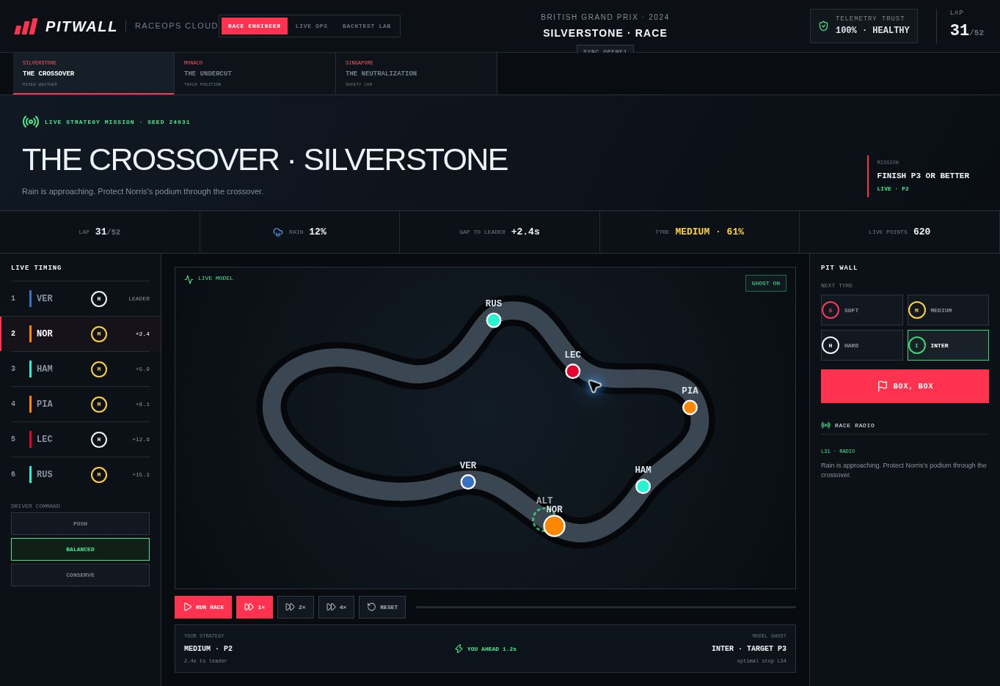
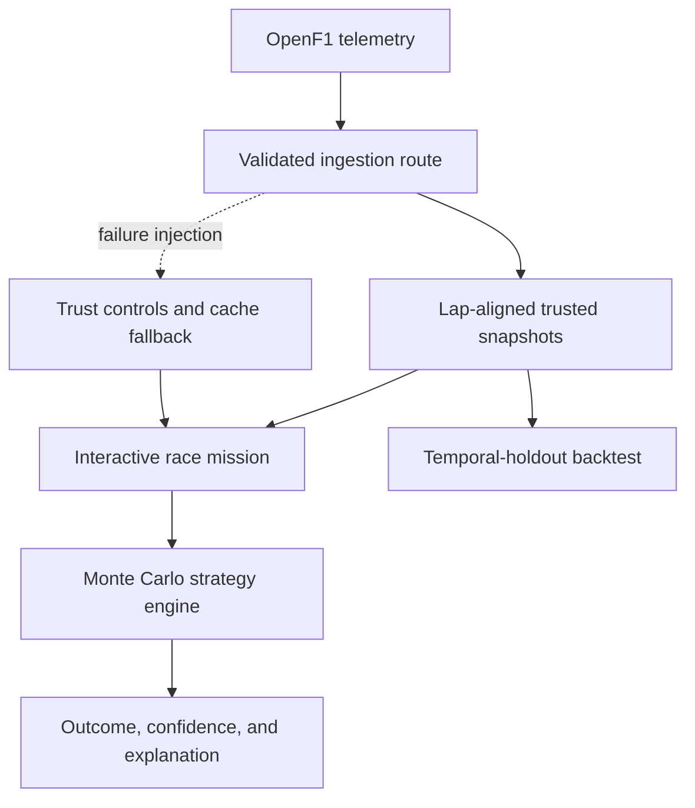

<div align="center">

# PITWALL

### Interactive F1 race strategy and telemetry-resilience simulator

[](https://github.com/arisharazakhan-cpu/pitwall-race-strategy-simulator/actions/workflows/ci.yml)
[](https://www.typescriptlang.org/)
[](https://nextjs.org/)
[](#verification)
[](LICENSE)

Make the call. Watch the race change. Defend the result.

</div>



## The experience

PitWall puts the player on the pit wall—not in front of a passive dashboard. Advance a live race, monitor moving cars and timing gaps, change driver pace, react to weather and safety-car interruptions, select the next tyre, call **BOX**, and compare the result against a live model ghost.

Every mission is deterministic and replayable. The chequered-flag result explains whether the call worked, where time was won or lost, and whether the mission objective was actually achieved. Finishing P4 in a podium mission is a failed mission, regardless of score.

| Mission | Decision pressure | Objective |
| --- | --- | --- |
| **The Crossover · Silverstone** | Mixed-weather tyre timing | Protect a podium |
| **The Undercut · Monaco** | Track position and traffic | Jump the car ahead |
| **The Neutralization · Singapore** | Safety-car pit timing | Convert the free stop |

## Why it is technically interesting

- **Live decision loop** — pause, 1×/2×/4× playback, animated circuit positions, changing gaps, tyre wear, rain, radio messages, pace commands, pit stops, and rejoin loss.
- **Probabilistic strategy engine** — reproducible 1,000-path decisions plus an asynchronous 100,000-path browser stress test with convergence telemetry.
- **Real race ingestion** — seven OpenF1 datasets are aligned into lap-level snapshots for the full driver field.
- **Honest backtesting** — inputs freeze at a selected lap, future data stays sealed, and the prediction is scored only after the observed result is revealed.
- **Resilient telemetry path** — schema checks, range validation, event deduplication, request timeouts, trusted-cache fallback, confidence penalties, and circuit-breaking behavior.
- **Controlled failure lab** — inject an outage, latency spike, corrupted event, replay storm, or weather-feed loss and watch the system degrade visibly without silently trusting bad data.
- **Explainable outcomes** — exposes tyre pace, degradation, traffic, pit timing, weather, safety-car effects, confidence, and an 80% outcome interval.

## System design



The server route discovers a race session, retrieves sessions, drivers, laps, positions, intervals, stints, and weather, validates the response shape, and reconstructs a consistent state for every replay lap. The browser engine then evaluates strategy choices without blocking animation or input.

## Engineering numbers

| Measure | Result |
| --- | ---: |
| Historical telemetry datasets | 7 |
| Modeled circuits | 5 |
| Playable missions | 3 |
| Standard simulation paths | 1,000 |
| Stress-test paths | 100,000 |
| Automated invariant tests | 11 |
| Failure scenarios | 5 |
| Outcome interval | 80% |

Measured performance and methodology are documented in [BENCHMARKS.md](docs/BENCHMARKS.md). Assumptions and limits are explicit in the [model card](docs/MODEL_CARD.md), and security boundaries are covered in the [threat model](docs/threat-model.md).

## Repository map

```text
app/                  Next.js interface and race-data route
components/           Simulator, mission, backtest, and five UI primitives
lib/                  Strategy engine, game rules, and circuit profiles
tests/                Determinism and race-behavior invariants
docs/                 Benchmarks, model card, threat model, and media
scripts/              Reproducible strategy benchmark
public/               PitWall favicon
```

## Run locally

Requires Node.js 22+ and pnpm.

```bash
git clone https://github.com/arisharazakhan-cpu/pitwall-race-strategy-simulator.git
cd pitwall-race-strategy-simulator
pnpm install
pnpm dev
```

Open `http://localhost:3000`.

## Verification

```bash
pnpm typecheck
pnpm test
pnpm benchmark
pnpm build
```

GitHub Actions runs type checking, all tests, a production build, and CodeQL analysis on every push and pull request.

## Data and limitations

Historical data is provided by the community-operated [OpenF1 API](https://openf1.org/). OpenF1 is unofficial and is not associated with Formula One companies or the FIA. PitWall is an educational engineering project, not confidential team strategy software. Simulation probabilities describe this model and its assumptions; they are not real team forecasts.

## Author

Built by **Arisha Raza** as an end-to-end demonstration of simulation, frontend interaction, cloud-ready API design, observability, testing, and cyber-resilience engineering.
